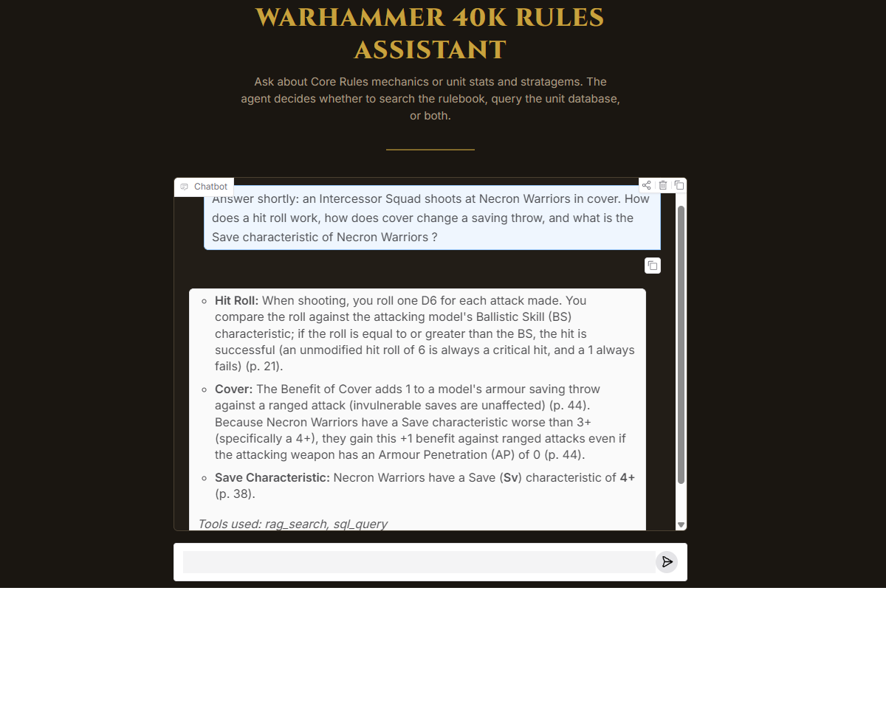

# Warhammer 40k Core Rules Assistant

A question-answering assistant for the Warhammer 40,000 Core Rules that combines late-interaction retrieval over the rulebook with **text-to-SQL** over a datasheet database, orchestrated by a **ReAct agent**. The project is evaluated end to end, with a baseline, ablations and latency measurements, and every evaluation run is saved with the full pipeline configuration. A Gradio interface (`python app.py`) also lets you query the assistant interactively.
This project was made during my RAG coursework and is not affiliated with Games Workshop.



## What it does

The agentic RAG implemented has to answer questions based on two kind of questions : based on rules ("how does a charge work ?"), on data ("how much armor has unit x") and often both. The agent decides which source to query, calls the tools and answers if it is satisfied, from the gathered evidences. 


### Architecture

```
OFFLINE (built once)
  Core Rules.pdf
    -> LightOnOCR-3 0.8B    page text (markdown)
    -> build_structure.py   sections.json: part > chapter > section tree, with page spans
    -> chunk.py             chunks.json: at most 700 tokens each, with pages and section path
    -> index.py             ColBERT (answerai-colbert-small-v1) + PLAID index
  wahadb.sqlite + data dictionary (the schema is given to the agent)

ONLINE (per question)
  question
    -> ROUND (max 5)
         TOOL LOOP (Gemini, max 5 tool turns)
           decides which tool(s) to call, reads the results, repeats
             rag_search(query)  -> query rewritten in rulebook terms, one per mechanic
                                -> ColBERT top-5 chunks (page_start, page_end, section path, text)
             sql_query(sql)     -> the agent writes a SELECT from the schema
                                -> SQLite rows, max 200
           no more tool call  -> candidate answer
           budget used up     -> one last tool-free call: "answer with the evidence you have"
         VERIFIER (separate Gemini call: question + evidence + candidate answer)
           satisfied          -> stop
           not satisfied      -> new round, the missing part is appended to the question
    -> returns: answer with (p. N) citations + evidence (every tool call, arguments, result)
```

- Evidence accumulates across rounds; the verifier sees all of it, and the evaluations use it to score routing, SQL and retrieval.
- Each ablation removes one block: `no_verify` drops the verifier, `closed_book` drops the tools, `raw_retrieval` drops the agent (question straight to ColBERT).


### Design decisions

- **Late interaction over dense retrieval.** Rulebook questions use precise terminology (Battle-shock, Desperate Escape, Devastating Wounds); token-level matching keeps those terms discriminative. The model is small and retrieval takes tens of milliseconds, so it is never the bottleneck.
- **Two tools.** Unit statistics, points and abilities live in a sqlite database; PDF contains general rules of the game. The tool descriptions state what each source does not contain, which drives routing.
- **A forced final answer.** When the tool budget is exhausted the agent makes one last tool-free call instead of returning nothing.

## Evaluation

All evaluation data is in `data/eval/`: 20 retrieval/RAG questions, 20 SQL questions with verified expected rows, and 20 agent questions (5 rules-only, 5 data-only, 10 mixed). Every metric below is computed on those sets

| Evaluation | Metric | Scoring | Result |
|---|---|---|---|
| Retrieval (raw question) | Recall@5 / MRR@5 | Page match | 0.85 / 0.77 |
| RAG generation | faithfulness / answer relevancy | LLM-as-a-judge | 0.83 / 0.81 |
| Text-to-SQL (isolated) | execution-result match | Value match | 19 / 20 |
| Agent | routing, SQL correctness, retrieval recall, answer correctness | LLM-as-a-judge for answer correctness only | see ablations |

How each metric is computed:

- **Retrieval:** a question is a hit if one of the top-5 chunks overlaps the annotated pages.
- **SQL:** a question passes if every expected row is found in the returned rows. Matching is by value, not by column name, so aliases do not matter.
- **Agent routing:** the set of expected tools must be included in the tools actually called.
- **Denominators:** SQL correctness is computed on the 15 questions that need SQL (data-only and mixed); retrieval recall on the 15 that need the rulebook (rules-only and mixed). These are structural, not dropped questions.
- **The judge is not the generator.** Generation is done by Gemini; the LLM judge is Claude Sonnet 5.5, a different model family, to avoid self-preference bias. It can be swapped for a Gemini judge with environment variables (see below).

### Ablations

Same 20 agent questions, all variants run in the same session.

| Variant | Routing | SQL | Retrieval | Answer | Mean latency | p95 latency |
|---|---|---|---|---|---|---|
| Baseline (full agent) | 0.95 | 0.93 | 0.93 | 0.90 | 13.24 s | 22.77 s |
| No verification loop | 0.90 | 0.93 | 0.87 | 0.90 | 9.07 s | 18.52 s |
| Closed book (no tools) | n/a | n/a | n/a | 0.70 | 2.54 s | 3.25 s |
| Raw-question retrieval (no agent) | n/a | n/a | 0.80 | n/a | 0.02 s | 0.03 s |

Reading the results:

- **Removing the verification loop saves latency** according to our evaluation, that however can be biased by the size of the set and the complexity of the questions.
- **Tools matter:** without them, answer correctness falls from 0.95 to 0.7. The closed-book judge has no evidence to check against, so this number is indicative.
- **Agent search finds one more page than the raw question** (0.87 against 0.80, one question out of 15). The advantage of reformulation is plausible but not established at this sample size.
- **Run-to-run noise is about one question.** Earlier baseline runs scored 1.00 / 1.00 / 0.93 / 1.00 on the same set.

### Latency

Latency is the wall-clock processing time of each stage, accumulated per question. In the baseline ablation run (mean 13.24 s per question):

| Stage | Mean per question | Share | Calls per question |
|---|---|---|---|
| Retrieval | 0.05 s | under 1% | 2.0 |
| Tool-calling turns (rules search) | 5.77 s | 44% | 2.25 |
| Tool-calling turns (SQL generation) | 1.66 s | 13% | 0.65 |
| Verification | 2.27 s | 17% | 1.1 |
| Final answer | 3.49 s | 26% | 1.15 |

About 84% of the time is spent in Gemini calls, around 4.7 sequential calls per question. Retrieval with the late-interaction model is not a latency problem on this corpus.

## Lessons learned

- **Compare values, not keys.** Text-to-SQL accuracy was 9/20 because the generated column names differed from the gold keys. Matching result values raised it without hiding real errors.
- **A tool budget needs an exit.** Without a forced final call, an exhausted loop returned an empty string.
- **Do not let a model grade itself.** The judge was moved to a different model family; scores before and after are not comparable, being slightly lower on multiple runs.

## Reproducibility

Every evaluation writes JSON files to `data/results/<timestamp>-<commit>[-dirty]/`: metrics, per-question outputs (queries, retrieved pages, answers, judge reasons), latency per stage, the pipeline description (OCR, chunking, indexing, retrieval, agent, judge), the git commit, package versions, and SHA-256 fingerprints of the chunks, database, gold sets and agent code (to detect any change between two runs). The `-dirty` suffix means tracked files had uncommitted changes.

## Run it

The Core Rules PDF and the datasheet database are not included. Place them at `data/Core Rules.pdf` and `data/wahadb.sqlite`.

```bash
uv sync
```

Create a `.env` file:

```
GEMINI_API_KEY=...
ANTHROPIC_API_KEY=...
```

Only the Gemini key is needed to run the app; the Anthropic key is used by the evaluation judge.

Build the pipeline (OCR takes longer):

```bash
uv run python src/ocr/ocr.py
uv run python src/pipeline/build_structure.py
uv run python src/pipeline/chunk.py
uv run python src/pipeline/index.py
```

Run the app:

```bash
uv run python app.py
```

Run all evaluations, then the ablations:

```bash
uv run python src/eval/run_all.py && uv run python src/eval/run_ablations.py
```

Use another judge without editing any file, for example a Gemini model different from the generator:

```bash
JUDGE_PROVIDER=gemini JUDGE_MODEL=<gemini-model-id> uv run python src/eval/run_all.py
```

## Repository layout

```
src/
  config.py            models, paths, retrieval and agent settings
  ocr/                 PDF to text
  pipeline/            structure, chunking, retrieval, RAG generation
  agent/               ReAct agent, SQL tool, data dictionary
  eval/                evaluations, ablations, judge, latency and result export
data/
  eval/                gold sets
  results/             run outputs (ignored by git)
```
